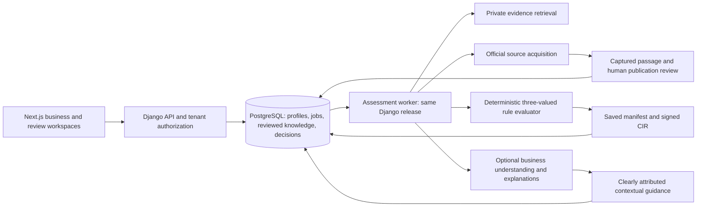

# ComplyWise architecture decision and implementation plan

Date: 18 October 2026. Scope: an incremental implementation using the reconciled repository; local verification, without a live deployment.

## Decision

Use the Markdown design's separation of legal decisions, evidence retrieval and explanatory AI, implemented as a modular Django core with PostgreSQL, a background worker from the same codebase, and a private retrieval service. Keep Next.js as the user interface. Preserve the scenario branch's useful flows and the current branch's acquisition and authentication fixes.

This is a better starting point than either original branch alone. The scenario branch supplies more of the intended application, but its structure did not prove correctness: the reconciled baseline had failing source projections, contract drift, unsafe defaults and retrieval integration gaps. The implementation adds explicit provenance and tested boundaries rather than treating a branch name or document as evidence of readiness.

“Most efficient” is a tradeoff between response time, correctness, operating cost and maintenance. There is no measured basis for declaring any architecture universally best. For this application's current corpus and deployment shape, one modular core and one database queue avoid an additional broker and distributed write coordination. A larger system should revisit that choice using production measurements.

## System boundary

Retrieval ranks candidates; a ranking score cannot establish applicability. A verified passage alone does not supply an executable condition. A reviewer approves the dated condition and its examples; the deterministic evaluator applies it to the saved business facts. Contextual AI output retains its separate provenance and cannot replace a rule result.

## Implementation sequence and acceptance criteria

| Stage | Change | Acceptance evidence |
|---|---|---|
| 1 | Reconcile scenario and current branches in an isolated checkout | Original core checkout remains clean; merged acquisition and authentication checks pass |
| 2 | Pin evaluation inputs, save CIR once, use RFC 8785 and configured signing keys | Catalogue edits cannot alter saved CIR/citations; tampering and missing signatures fail verification; key rotation works |
| 3 | Add persistent assessment jobs and frontend polling | Duplicate submissions reuse a job; failures roll back; retries are bounded; expired claims recover; two PostgreSQL workers cannot claim the same queued operation |
| 4 | Gate publication with dates and executable positive, negative and missing-fact examples | Invalid examples cannot publish; reviewed content cannot be edited through ordinary model saves; effective versions are selected by evaluation date |
| 5 | Track changed captures, affected rules and decision runs; schedule reviewed reassessment | Source review is audited; replacement evidence is required; a new run is created while the old record remains accessible |
| 6 | Index the actual retrieval corpus; filter before ranking; benchmark | Actual KB schema loads; unsigned/replayed requests fail; state/date boundaries hold; currentness is not inferred from existence |
| 7 | Integrate coverage reporting and a shared four-question policy | The UI states catalogue limits; old questionnaire caches are invalidated; unresolved gaps can be deferred |
| 8 | Verify contracts, browser flows, migrations and PostgreSQL behaviour | See the implementation status and evidence files for actual results and limits |

## Research and decisions

1. [Microsoft's asynchronous request-reply pattern](https://learn.microsoft.com/en-us/azure/architecture/patterns/asynchronous-request-reply) describes accepting work and exposing a status resource, including retry guidance. The implementation uses persisted jobs, HTTP 202, Location, Retry-After and assessment-scoped retry keys. It does not claim exactly-once external calls.
2. [OPA decision logs](https://www.openpolicyagent.org/docs/management-decision-logs) record decision inputs and policy revisions. That supports pinning the exact rule/evidence catalogue and evaluator version for each ComplyWise run; adopting OPA itself is unnecessary for the existing AST evaluator.
3. [Microsoft's RRF documentation](https://learn.microsoft.com/en-us/azure/search/hybrid-search-ranking) explains combining ranked result lists. The optional dense path uses RRF instead of interpreting incomparable lexical and vector scores as applicability probabilities. Indexed BM25 remains the default until a real local embedding model improves a labelled retrieval benchmark.
4. [Microsoft's RAG evaluation guidance](https://learn.microsoft.com/en-us/azure/architecture/ai-ml/guide/rag/rag-solution-design-and-evaluation-guide) supports evaluating retrieval and generated answers separately. The included synthetic benchmark establishes software behaviour and latency, not recall over Indian law.
5. [PostgreSQL row security](https://www.postgresql.org/docs/current/ddl-rowsecurity.html) has owner and privileged-role bypass behaviour. Application authorization is tested here. Database row-level policies require a separately designed tenant/session context and restricted production role; an untested policy migration would not establish isolation.
6. [Microsoft's microservices architecture guidance](https://learn.microsoft.com/en-us/azure/architecture/microservices/) describes the additional operational demands of distributed services. Keep business writes in the existing modular core; split further only when independent scaling or ownership justifies it.

## Remaining decisions that require measurements or deployment context

### Follow-up: effective procedural releases

RequirementRevision stores dated, reviewed descriptions and procedural metadata separately from stable catalogue identity. Publication creates a revision and links its immutable rule; manifests capture the selected revision and catalogue history. Selection uses latest effective start, then publication version for corrections with the same start. A backdated correction cannot displace a later-dated release. An expired or withdrawn selected procedural release produces UNVERIFIED rather than reviving older instructions.

The modular core and batched catalogue reads remain. [Django row locking](https://docs.djangoproject.com/en/6.0/ref/models/querysets/#select-for-update) supports locking the stable requirement row while allocating versions. PostgreSQL concurrent-review tests exercise that implementation. [PostgreSQL range constraints](https://www.postgresql.org/docs/16/rangetypes.html#RANGETYPES-CONSTRAINT) offer non-overlap enforcement, but this implementation uses a superseding release timeline: older open-ended records stay immutable and the latest effective release takes precedence. Stored intervals may overlap.

Effective date and recorded review time are distinct. A new evaluation of an old date uses currently reviewed knowledge applicable on that date. An archived decision retains the knowledge recorded when that decision was made. This is not a general bitemporal query engine.

### Remaining measurements

- Establish production latency, queue-age, error-rate, provider-cost and retrieval-quality targets, then load-test against the expected user volume.
- Validate an actual embedding model on labelled queries before enabling dense serving. Synthetic vectors test fusion mechanics only.
- Review legal commencement dates, jurisdiction coverage, exceptions and source validity with qualified reviewers. The current retrieval catalogue is not an exhaustive verified legal corpus.
- Define restricted database roles, tenant context, retention and backup restoration. Application write guards and HMAC verification do not make a database administrator unable to alter data.
- If stage duration or concurrency grows materially, separate network acquisition from the short transactional commit. The initial worker retains the existing orchestrator's transaction boundary to make its current writes recoverable.
- Verify release images, migrations, worker configuration and live traffic separately before claiming a production rollout.
